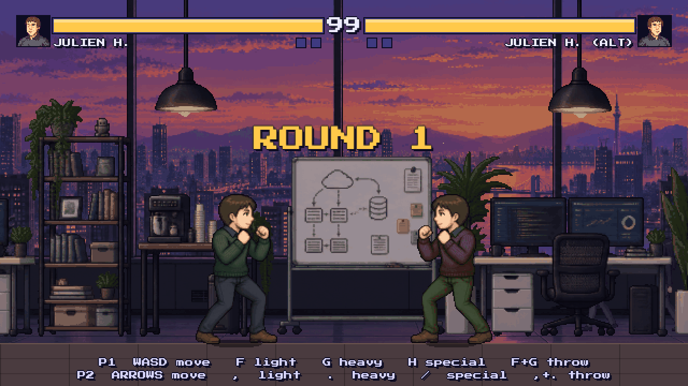
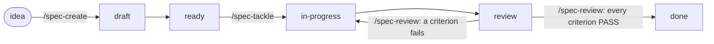

# Datamon: Merge Conflict

A 2D pixel-art 1v1 fighting game starring Compass colleagues, built in one day by a handful of Claude Code sessions working in parallel. The human made the decisions; the agents wrote the specs, generated and processed the art, built the engine and verified each other's work.

**Play it:** https://datamon-game.julienh15.workers.dev



This repo is also a working example for AI onboarding: everything an agent needs to build, test, verify and ship the game lives in the repo. The [agent setup](#how-the-repo-is-set-up-for-agents) section explains each piece.

## Controls

| | Move | Light | Heavy | Special | Throw |
|---|---|---|---|---|---|
| Player 1 | WASD | F | G | H | F+G |
| Player 2 | Arrows | , | . | / | , + . |

## Run it locally

Needs Node 20+.

```sh
npm ci
./dm dev        # starts Vite in the background and prints the URL
./dm check      # typecheck, tests, build
```

## The `dm` CLI

`./dm` is the one interface for working in this repo, written for agents first: every command has a stable exit code, writes its full log to `.dm/logs/<name>.log`, and prints a single JSON object with `--json`. It is plain Node with no dependencies (`scripts/dm.mjs`).

| Command | What it does |
|---|---|
| `./dm doctor` | Checks Node, dependencies, git state and the Cloudflare and GitHub logins |
| `./dm dev [start\|stop\|status]` | Runs the Vite dev server in the background on a free port and records it in `.dm/dev.json` |
| `./dm check [--only test,build]` | Runs the gates in order (typecheck, test, build), one line each, and stops at the first failure with the log's tail |
| `./dm build` | Production build into `dist/` |
| `./dm preview` | Runs the gates, then uploads a preview version to Cloudflare without making it live and prints its URL |
| `./dm deploy` | Refuses a branch other than `main` or a dirty tree, runs the gates, deploys, then smoke-tests the live page and a fighter asset |
| `./dm url` | Prints the production URL from the last deploy |
| `./dm status` | Git state, dev server, last deploy (and whether it matches HEAD), spec counts by status |
| `./dm specs [--status review]` | Every spec with its status and criteria and task progress |

Exit codes: `0` ok, `1` a gate, deploy or smoke test failed, `2` usage error, `3` missing prerequisite (dependencies or a login).

## Deploy

The game is a static Vite build served by a [Cloudflare Worker with static assets](https://developers.cloudflare.com/workers/static-assets/). There is no server code: `wrangler.jsonc` points the Worker at `dist/`.

```sh
npx wrangler@4 login   # once
./dm preview           # a preview URL to check before going live
./dm deploy            # production
```

`./dm deploy` ties every production deploy to a commit (it refuses uncommitted changes unless you pass `--allow-dirty`), stamps the commit in the Cloudflare version message, and fails if the live page or a fighter asset does not load afterwards.

## How the repo is set up for agents

The game was built by several Claude Code sessions at once: one building the game, one writing the QA agent, one setting up daily research, and short-lived builder agents in git worktrees. These pieces kept that from turning into chaos.

### 1. `CLAUDE.md`: the map

[`CLAUDE.md`](CLAUDE.md) is what every session reads first. It is short and only holds what an agent can't work out from the code: the stack, the one binding rule (`src/sim` is a pure, deterministic 60 Hz simulation), where the assets are and what they mean, how to keep the project HQ current, and which skills drive the work.

### 2. Spec-driven development

Every feature is a numbered spec in [`specs/`](specs/README.md), and three project skills in [`.claude/skills/`](.claude/skills) move it through its lifecycle:



- **`/spec-create`** writes a spec another session could build without asking questions: Goal, Context, numbered Requirements, Acceptance criteria that each trace to a requirement, Out of scope, Decisions, Open questions and an ordered Task list. Every criterion has to be checkable: a command, a test, or something concrete to see in the running game. "Feels good" does not count.
- **`/spec-tackle`** builds one spec a task at a time, proves each criterion and records the evidence (the command and its exit code, the test name, a screenshot in `specs/evidence/NNN/`). It can only move a spec to `review`, never to `done`, and it can't change the acceptance criteria on its own.
- **`/spec-review`** verifies independently. It reads the diff, re-runs every check itself instead of trusting the notes, and gives each criterion PASS, FAIL or UNVERIFIED with evidence. It never fixes code: failures go back to the spec as new tasks for `/spec-tackle`.

The point is that "done" means another agent checked it, and the spec file alone is enough for a fresh session to resume work.

### 3. The design doc holds decisions and binding rules

[`docs/game-design.md`](docs/game-design.md) records every decision the human made (in interview rounds, with dates) and the architecture rules all specs must follow. The key one: the simulation is fixed-step, integer-based and deterministic, with no clock, DOM or `Math.random`. That is what lets agents verify gameplay headlessly. The same inputs always produce the same state hash, so combat rules are unit tests instead of eyeballing.

### 4. The project HQ

Progress and open decisions live in a private Claude artifact (a web page with its own database), not in chat. Sessions update it whenever a spec changes status. The human changes decisions on that page (game title, stages, round length, and so on), and every session starts by applying any changed decisions to the design doc and specs. The page source is [`hq/template.html`](hq/template.html). The live page is private to the owner.

### 5. `game-qa`: a QA subagent that plays the game

[`.claude/agents/game-qa.md`](.claude/agents/game-qa.md) is a playtester. It runs the game in its own headless Chrome (a pinned `chrome-devtools-mcp` server declared in the agent's frontmatter, so it never collides with a browser another session is using) and tries to break it: input mashing, opposite directions held together, stuck keys, corners, cross-ups, tab throttling, resizes, bad URL parameters and reloads.

- It reads `window.__game.simFrame` and holds keys for exact numbers of simulation frames, not wall-clock time.
- It reproduces every finding twice, the second time from a fresh reload, and reports how often it happened.
- A `PreToolUse` hook ([`.claude/hooks/qa-write-guard.sh`](.claude/hooks/qa-write-guard.sh)), registered in the agent's frontmatter, lets it write only under `.qa/` and blocks state-changing git commands and dependency changes. QA can't "fix" what it is testing.
- It returns its report as its final message, and the caller saves it as `.qa/<run>/report.md`, so the next run re-tests every open finding.

### 6. Daily research that feeds the backlog

The [`game-research`](.claude/skills/game-research/SKILL.md) skill researches what great fighting games do, checks each idea against the design's constraints, and keeps a scored, ranked list of proposed additions in [`docs/research/additions.md`](docs/research/additions.md), with sources tagged `[primary]` or `[secondary]`. It never edits code or specs and never commits: adopting an idea is the human's call, through `/spec-create`.

It runs every morning through launchd as a headless Claude session locked down so it can't do anything else:

```sh
claude -p "Run the game-research skill in --daily mode ..." \
  --restricted --strict-mcp-config \
  --tools Read Glob Grep WebSearch WebFetch Edit Write \
  --permission-mode dontAsk \
  --allowedTools Read Glob Grep WebSearch WebFetch "Edit(docs/research/**)" \
  --max-budget-usd 5 --output-format json
```

`--restricted` ignores the user's permissive settings, `--tools` leaves it no shell, and `dontAsk` denies anything not explicitly allowed, so writes can only land in `docs/research/`. The wrapper turns the run's final `STATUS:` line into a macOS notification.

### 7. An art pipeline where only one step costs money

Fighter animations are image-generated, one clip per image, then processed by deterministic Python in [`art/pipeline/`](art/pipeline): cut the strip into frames, normalize scale, lock colors to the fighter's palette, anchor the feet, derive hit and hurt boxes from the silhouettes, and pack an atlas. Every generation call is logged to `art/generation-log.jsonl`. The human approves or rejects each clip in the HQ's Animation lab before it is packed. Generation itself calls a local image plugin that isn't in this repo; every step after it re-runs from the committed frames.

### 8. Many sessions, one checkout

How the parallel sessions stayed out of each other's way:

- **Each session owns its files** and commits only those, staged by path, never `git add -A`. Shared files (like `CLAUDE.md`) go through one owner.
- **Builder agents work in git worktrees** (`.claude/worktrees/`, ignored) and the lead session merges their branches.
- **"Done" is never taken on trust.** The lead reads the worker's diff and re-runs the gates itself before merging.
- **Checks are judged by exit code,** never by grepping output for "error". The `dm` CLI is built around that.

## Repo layout

| Path | What's there |
|---|---|
| `src/sim` | The pure, deterministic simulation (state machines, frame data, hit resolution) |
| `src/engine`, `src/input`, `src/render`, `src/audio`, `src/scenes`, `src/ai` | Real-time loop, devices, drawing, WebAudio, scenes, CPU opponent |
| `src/data` | Move and combat tables, fighters and their hitboxes, the Datamon catalog |
| `public/` | Datamon portraits and walk sheets, packed fighter atlases, effects, stage layers |
| `art/` | The animation pipeline, per-fighter frames, overrides and the generation log |
| `specs/` | Specs, their index and screenshot evidence |
| `docs/` | Game design doc and daily research |
| `.claude/` | Project skills, the `game-qa` agent and its hook |
| `hq/` | Source of the HQ page |
| `scripts/dm.mjs`, `dm` | The agent CLI |

The fighters are real Compass colleagues from the Datamon asset set, so their portrayal stays friendly: the jokes are about the work, never about the people.
