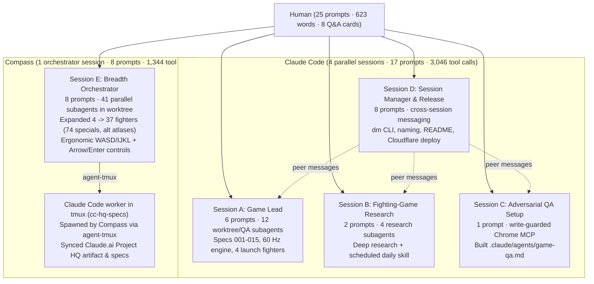

# Prompt Analytics: How Compass: Cardinal Clash Was Built

This document extracts **every prompt the human typed** across **Claude Code** and **Compass** to build, test, polish, and deploy *Compass: Cardinal Clash* from an empty directory to a live 37-fighter game in one day (`2026-11-12 14:28` to `00:50 EST`).

It is included in the repository for onboarding: new hires can inspect the exact inputs alongside the specs, commits, harnesses, and tests they produced.

---

## Headline Numbers

| Metric | Value | Notes |
|---|---|---|
| **Elapsed build window** | **~10.5 hours** | `14:28 EST` first prompt to `00:50 EST` full 37-fighter + HQ sync |
| **Interactive sessions** | **5** | `4` in **Claude Code** + `1` in **Compass** |
| **Unique human prompts** | **25** | `17` in Claude Code (`439` words) + `8` in Compass (`184` words) |
| **Total words typed by human** | **623 words** | About two-thirds of one page of prose across the entire project |
| **Prompt length** | **19 words median** | `24.9` words mean · shortest `3` words · longest `85` words |
| **Structured Q&A rounds** | **8 cards (22 picks)** | `5` in Claude Code + `3` in Compass (`AskUserQuestion` / `ask_user`) |
| **Delegated subagents & workers** | **71 runs** | `22` Claude subagents + `8` peer/headless/`tmux` Claude runs + `41` Compass breadth subagents |
| **Total agent tool calls** | **4,390** | `3,046` in Claude Code + `1,344` in Compass (**~176 tool calls per prompt**) |
| **AI art strip generations** | **1,034** | Logged in `art/generation-log.jsonl` across 37 fighters, VFX, and stage layers |
| **Shipped code & specs** | **24,650 lines** | `20,192` LOC TypeScript (`94` files) + `3,156` LOC Python (`20` files) + `1,302` lines across `15` specs |
| **Automated verification** | **875 tests** | `523` Vitest engine/flow/input tests + `352` Python art-pipeline `pytest` checks |
| **Git commits shipped** | **68+** | Live on Cloudflare Workers at https://datamon-game.julienh15.workers.dev |

---

## How Claude Code and Compass Divided the Work

Rather than funneling everything through one long chat window, the human ran **5 focused interactive sessions** across **Claude Code** and **Compass**, matching each harness to the shape of the work and even having Compass spawn Claude Code in `tmux` when a task needed Claude's native artifact database tools.

| Session | Harness | Window (EST) | Human Prompts | Delegated Workers | Tool Calls | Primary Responsibility |
|---|---|---|---:|---:|---:|---|
| **A — Game Lead** | Claude Code | `14:28–22:28` | 6 (+5 Q&A) | 12 subagents | 811 (+1,297 sub) | Scaffolded repo & `/spec-*` skills, interviewed on design, built deterministic 60 Hz sim, art pipeline, 4 launch fighters, audio, PWA & touch controls (specs `001`–`015`). |
| **B — Research Loop** | Claude Code | `14:33–18:54` | 2 | 4 subagents + 3 headless | 92 (+351 sub) | Researched fighting-game design fundamentals and packaged `.claude/skills/game-research/` with a locked-down daily `launchd` runner. |
| **C — QA Engineer** | Claude Code | `14:36–14:57` | 1 | 2 smoke-test runs | 24 (+88 sub) | Built `.claude/agents/game-qa.md` + `.claude/hooks/qa-write-guard.sh` so a headless browser playtester could try to break the game without editing code. |
| **D — Ops & Manager** | Claude Code | `14:48–22:26` | 8 (+2 Q&A) | Peer-managed A/B/C | 153 | Monitored sibling sessions via cross-session notifications, built the agent-first `./dm` CLI, named *Compass: Cardinal Clash*, wrote onboarding docs, and shipped to GitHub & Cloudflare. |
| **E — Roster & UX** | Compass | `20:56–00:50` | 8 (+3 Q&A) | 41 subagents + 1 `tmux` CC | 420 (+924 sub + 62 tmux) | Planned in a git worktree and fanned out 41 parallel subagents to ship **all 33 remaining fighters** (37/37 roster, 74 specials, 37 mirror-match alt atlases), upgraded default controls (`WASD+FQER` / `IJKL+HUOP` + Arrow/Enter menus), and spawned Claude Code in `tmux` to sync the Project HQ artifact. |

---

## Prompt Anatomy & Distributions

### 1. Prompt Length Distribution (No "Mega-Prompts")

None of the 25 prompts exceeded 85 words. Typos were left unedited (`"interview me on certian decisions"`, `"cldouflare"`, `"i liek"`, `"breadwidth"`): clear intent beat polished prose every time.

| Word Count Bucket | Prompts | Share | Examples |
|---|---:|---:|---|
| **3–10 words** (Directives & gates) | **9** | 36% | `"deploy it for me"`, `"Compass: Cardinal Clash i liek"`, `"can we keep going with the rest of the characters?"`, `"land it to the main branch now and cleanup"` |
| **11–25 words** (Focused nudges) | **6** | 24% | `"Lets research on what constitues a great fighting game -> lets do a deep research on it"`, `"[screenshot] oh yeah and just when navigating here make it like arrow keys and enter works..."` |
| **26–50 words** (Scoped goals & orchestration) | **8** | 32% | `"Ok lets work on expanding the characters we only have 4 but lets add more - and make characters feel unique - work in a worktree branch for this..."` |
| **51–85 words** (Multi-part milestones) | **2** | 8% | Core game kickoff + interview request (`59w`); Cloudflare deploy + `./dm` CLI + public onboarding repo brief (`85w`) |

### 2. Prompts by Engineering Intent

| Intent Category | Count | Share | What the Human Was Doing |
|---|---:|---:|---|
| **Ship & Deploy** | **5** | 20% | Approving branch merges, cleanup, GitHub pushes, and `./dm deploy` gates |
| **Architecture & Harness** | **4** | 16% | Asking for `/spec-*` skills, the `game-qa` subagent, the scheduled `game-research` skill, and the `./dm` CLI |
| **Orchestration** | **4** | 16% | Checking sibling sessions, delegating breadth work in git worktrees, and handing Project HQ updates across harnesses |
| **Product & Polish** | **4** | 16% | Expanding the roster (`4 -> 12 -> 37`), smoothing animations, and making 2P keyboard + menu controls feel natural |
| **Taste & Pivot** | **4** | 16% | Pivoting from procedural sprites to AI-generated animation strips and steering the game's title |
| **Vision & Interview** | **1** | 4% | Defining the 2D pixel fighter premise, requiring deterministic game-loop logic, and asking to be interviewed |
| **Production Readiness** | **1** | 4% | Setting the release bar: accessibility, responsive layout, load speed, memory, and CPU budgets |
| **Research & Knowledge** | **1** | 4% | Commissioning deep domain research on what makes fighting games feel great |
| **Documentation** | **1** | 4% | Extracting prompt analytics and updating GitHub for new hires |

---

## Five Takeaways for New Hires

1. **Build the harness before building the app.**
   Look at Prompts `#1`, `#8`, `#9`, and `#12`: four of the earliest prompts didn't ask for game features at all. They built `/spec-create`, `/spec-tackle`, `/spec-review`, an adversarial `game-qa` browser playtester with write-guards, a daily research skill, and `./dm` (a zero-dependency CLI with deterministic exit codes). Because those rails existed by 3:00 PM, later prompts as short as `"deploy it for me"` (`4` words) or `"can we keep going with the rest of the characters?"` (`10` words) ran safely without hand-holding.
2. **Tell the agent to interview you instead of writing a wall of requirements.**
   Prompt `#2` says: *"interview me on certian decisions -> lets follow with the spec workflow"*. Rather than forcing the human to anticipate 20 design questions up front, the agents surfaced **8 structured multiple-choice cards** (sometimes opening live visual comparisons in Preview/Safari first). Twenty-two product decisions were locked into `docs/game-design.md` in seconds.
3. **Stay at the architecture, taste, and verification boundary.**
   Zero prompts dictated file names, TypeScript types, hitbox coordinates, or CSS rules. The human stated *invariants* (`"strong logic on the game loop"`, `"work in a worktree branch"`), exercised *taste* (`"oOk that was example lets make a high quality game - focus on the animations"`, `"make it like arrow keys and enter works so it feels natural"`), and controlled *irreversible gates* (merging to `main`, making the repo public, deploying to production).
4. **Match the harness to the shape of the task — and combine them.**
   **Claude Code** ran deep, stateful spec/QA/research loops and owned the private Claude.ai Project HQ artifact. When it was time to scale from **4 fighters to all 37 colleagues** (generating ~900 new sprite strips, 33 bespoke kits, 66 new specials, and 37 alt atlases), **Compass** orchestrated **41 background subagents** in waves inside an isolated git worktree — then spawned Claude Code inside `tmux` (`agent-tmux`) so Claude could update its own Project HQ artifact database.
5. **Screenshots + one sentence beat long UI bug descriptions.**
   In Prompt `#24`, pasting a screenshot of the screen with *"oh yeah and just when navigating here make it like arrow keys and enter works so it feels natural for people"* (`21` words) was enough to wire unbound `Arrow` + `Enter` navigation across all five menu scenes while keeping live key-binding tests isolated.

---

## Complete Chronological Prompt Log

Prompts are reproduced **verbatim as typed** (typos included) in chronological order per session. Local temporary screenshot paths (`/var/folders/.../pi-clipboard-*.png`) are replaced with `[attached screenshot]`. Structured Q&A picks (`AskUserQuestion` / `ask_user`) appear inline right where the human answered them.

### Session A · Claude Code — Game Lead (`14:28–22:28 EST`)

| # | Time (EST) | Words | Verbatim Prompt / Structured Decision | What Happened |
|---|---|---:|---|---|
| **P1** | `14:28:08` | 45 | `Lets make an app - lets just create the repo init git -> going to use my datamon assets - assets of people at compass. Lets make a fun game.`  `lets start with some basics skills for spec driven -> lets createa spec-create, spec-tackle, spec-review` | Initialized `datamon-game`, copied the 37 colleague portraits/walk sheets + 35 battlemon sprites from `../minecraft-clone`, and authored `.claude/skills/spec-{create,tackle,review}/` (`1b3d984`). |
| **P2** | `14:32:44` | 59 | `Lets make a fighting game - 2D - 8bit pixel, lets have strong logic on the game loop -> cool animations, make it fun and enjoyable - use the datamon assets - use our character models as the character list`  `interview me on certian decisions -> lets follow with the spec workflow we have here only in this project` | Triggered two structured design interviews and wrote the binding 60 Hz deterministic integer sim rules in `docs/game-design.md`. |
| *Q&A 1* | `14:34:27` | *4 picks* | **Players:** `Local 2P + vs CPU` · **Style:** `Classic 1v1, simple inputs` · **Animations:** `Procedural + VFX` *(initial spike)* · **Battlemons:** `Assist summons` | Recorded Round 1 decisions in `docs/game-design.md`. |
| *Q&A 2* | `14:35:40` | *4 picks* | **Pixel look:** `B: Arcade middle` *(from live Preview comparison)* · **Roster:** `All 37, archetype-based` · **Stages:** `Code-drawn pixel stages` · **Tone:** `Compass in-jokes` | Built visual prototype to preview sprite scale in browser before committing to an art pipeline. |
| **P3** | `14:48:35` | 23 | `oOk that was example lets make a high quality game - focus on the animations can use image gen to create web assets` | Pivoted from procedural sprite transforms to AI-generated animation strips normalized by a deterministic Python pipeline (`art/pipeline/`). |
| *Q&A 3* | `14:53:39` | *4 picks* | **Canvas & fighter size:** `640x360, 140px fighters` *(after live 3-size Safari timing preview)* · **First batch:** `4 launch fighters` · **Clip depth:** `Core set, ~16 strips` · **Stages & VFX:** `Yes, both image-generated` | Created specs `001`–`004` and the Project HQ artifact; built deterministic engine (`src/sim`), hit/hurtbox derivation, VFX atlas, and best-of-3 combat (`97c3296`..`52510f0`), followed by first `game-qa` run (`00c7437`). |
| **P4** | `17:16:52` | 37 | `ok make it more refined, make it so i can choose different characters and foucs on the controls so its more natural for two people to do it.`  `I like the animations flesh it out more please` | Kicked off Round 3 expansion: character select, 2-player keyboard split + rebinding, 26-clip v2 animation sets, CPU AI, painted parallax office stage, and WebAudio synth music/SFX. |
| *Q&A 4* | `17:19:49` | *4 picks* | **Buttons:** `Punch / Kick / Special` · **2P keyboard:** `Home row split` · **Select roster:** `4 fighters, own specials` · **Polish:** `Smoother moves, More moves & reactions, Sound & music, Living stage & menus` | Authored and executed specs `005`–`010` & `012` across parallel worktree builder subagents (`87ea766`..`4ba7901`). |
| **P5** | `19:02:10` | 34 | `ok goal is get app ready in working and proper state good interface, easilyl accessilbe like its a publish release and a proper app - repsonsive and optimized for speed and memory and cpu` | Spawned 3 parallel worktree builders for spec `013` (WebP atlases, walker strip, fighter index, perf budgets), spec `014` (PWA shell, fullscreen, screen-reader announcer, blur pause), and spec `015` (mobile touch controls & landscape lock), followed by two `game-qa` passes and fixes `F1`–`F3` (`5e929c0`..`c383a5b`). |
| **P6** | `22:14:43` | 4 | `deploy it for me` | Ran `./dm deploy`, detected a Wrangler account switch from another terminal, and surfaced Q&A 5 before pinning `account_id`. |
| *Q&A 5* | `22:17:46` | *1 pick* | **Cloudflare target:** `Personal account` *(public Workers URL rather than Access-gated org account)* | Pinned `account_id` in `wrangler.jsonc` (`8f614a5`) and deployed v1 live. |

---

### Session B · Claude Code — Fighting-Game Research & Daily Skill (`14:33–18:54 EST`)

| # | Time (EST) | Words | Verbatim Prompt | What Happened |
|---|---|---:|---|---|
| **P7** | `14:33:24` | 17 | `Lets research on what constitues a great fighting game -> lets do a deep research on it` | Launched 4 parallel research subagents covering combat depth, frame/hitstop feel, input buffering/accessibility, and genre case studies. |
| **P8** | `14:44:47` | 30 | `now lets make this into a resuseable skill that runs every day and saves to a location and then tries to expand and find the greatest additions to our game` | Built `.claude/skills/game-research/`, verified read/write sandbox boundaries with headless permission tests, and scheduled a daily `$5`-capped `--restricted` `launchd` job writing ranked ideas to `docs/research/additions.md`. |

---

### Session C · Claude Code — Adversarial `game-qa` Subagent (`14:36–14:57 EST`)

| # | Time (EST) | Words | Verbatim Prompt | What Happened |
|---|---|---:|---|---|
| **P9** | `14:36:29` | 43 | `Lets setup a project subagent here that is for reviewing the game - it should play the game to the extent that it can, should observe behavorial, try ot break the existing game on the interface - will be used for quality assurance` | Created `.claude/agents/game-qa.md` with an isolated `chrome-devtools-mcp` instance and `.claude/hooks/qa-write-guard.sh` (blocking edits outside `.qa/`), then validated it via two smoke-test runs before handing it to Session A. |

---

### Session D · Claude Code — Multi-Session Manager, `./dm` CLI & Public Launch (`14:48–22:26 EST`)

| # | Time (EST) | Words | Verbatim Prompt / Structured Decision | What Happened |
|---|---|---:|---|---|
| **P10** | `14:48:58` | 10 | `what are my other sessions working on in this repo` | Inspected active local transcripts/worktrees and summarized Sessions A, B, and C. |
| **P11** | `14:53:36` | 19 | `lets manage all my sessions here continue and keep the other sessions going on what they should be doing` | Subscribed to cross-session idle notices and coordinated smoke checks and `launchd` verification with Sessions B and C while Session A built combat. |
| **P12** | `17:49:07` | 85 | `ok while one session is working on the game lets plan how we can deploy this to cldouflare easiliy i've logged in with npx wrangler@4 login - get the game out there.`  `Lets make deploy easy - make a cli for the agent to develop and do things.`  `And htis was for an ai onbaording so get this rpeo out on github public and jst explain the spec driven setup we have and the other things we engineered for agents in this repo to work.` | Built `./dm` (`scripts/dm.mjs`), configured Cloudflare Workers static asset deployment (`wrangler.jsonc`), wrote the initial onboarding `README.md`, and checked public visibility intent (`c4cf6ae`..`a0a4892`). |
| *Q&A 6* | `17:52:45` | *1 pick* | **Visibility:** `Public repo + public site` | Created public GitHub repository `JewelsHovan/datamon-game` and pushed `main`. |
| **P13** | `18:02:57` | 11 | `come up with more interesting name for the game too haah` | Proposed initial git-pun titles; human rejected the generic picker to steer toward a Compass-themed title. |
| **P14** | `18:04:24` | 10 | `Somethign like compasss and fighting game com eup more interesting` | Generated cardinal/navigation fighting-game names including *Compass: Cardinal Clash*. |
| **P15** | `18:26:30` | 5 | `Compass: Cardinal Clash i liek` | Renamed the game across the title screen, HTML shell, `README.md`, `CLAUDE.md`, and Project HQ (`fc04a06`). |
| **P16** | `21:10:55` | 3 | `i pusehd lol` | Re-synced remote state after human pushed from terminal. |
| **P17** | `22:24:50` | 4 | `ok its good go` | Verified live production deployment after `wrangler.jsonc` account pin. |

---

### Session E · Compass — Full 37-Fighter Expansion, Ergonomic Controls & Cross-Harness Sync (`20:56–00:50 EST`)

| # | Time (EST) | Words | Verbatim Prompt / Structured Decision | What Happened |
|---|---|---:|---|---|
| **P18** | `20:56:12` | 43 | `Ok lets work on expanding the characters we only have 4 but lets add more - and make characters feel unique - work in a worktree branch for this. Orchestrate and plan here and then delegate in breadwidth manner to gemini hydrogen model` | Explored the art/sim pipeline, created an isolated git worktree (`feat/character-expansion`), and asked 3 scoping questions before fanning out subagents. |
| *Q&A 7* | `21:07:13` | *3 picks* | **First wave size:** `+8 fighters (12 total)` · **Selection:** `Recommended visual mix` · **Uniqueness depth:** `Full unique kit (2 specials + physics)` | Wrote spec `016`, added `Forward+Special` (2nd signature special) + `Down+Special` taunt + bespoke fighter physics/traits, generated 8 full 26-clip fighter atlases in parallel subagent waves, and passed all checks. |
| **P19** | `21:53:23` | 10 | `can we keep going with the rest of the characters?` | Scoped the remaining 25 colleagues from `datamonCatalog.js` (`spec 017`). |
| *Q&A 8* | `22:14:26` | *1 pick* | **Second wave size:** `All 25 remaining (37/37 full roster)` | Fanned out parallel subagent waves across all **25 remaining colleagues** (zero "coming soon" tiles left), wired **74 unique specials**, assigned all **35 Battlemon companions**, upgraded CPU AI & dynamic stage walkers, and built offline garment-aware mirror-match `atlas-alt.webp` sheets for all 37 fighters (`5d1413c`, `872724c`). |
| **P20** | `23:24:38` | 9 | `land it to the main branch now and cleanup` | Re-ran Vitest + `pytest` gates, merged the worktree branch cleanly onto `main`, and removed temporary worktree artifacts. |
| **P21** | `23:25:03` | 5 | `and then deploy please :)` | Ran `./dm deploy` and verified all 37 fighters live on Cloudflare Workers. |
| **P22** | `23:41:44` | 50 | `send claude code to update its spec now and also btw can we just make default controls for both players more naturla say like wasd -> and then f, q, e, r makes sense and for player 1 nabey jkli for movemnt then the keys around it but good work` | Switched default bindings to single-hand clusters (`P1: WASD + F/Q/E/R`, `P2: IJKL + H/U/O/P`), bumped storage to `datamon.controls.v2`, updated input/flow tests, and deployed (`1985208`). |
| *Q&A 9* | `23:45:43` | *default* | **Non-blocking default:** `P1: WASD + F/Q/E/R, P2: IJKL + H/U/O/P` *(proceeded immediately without blocking)* | Applied immediately while keeping the swap option open. |
| **P23** | `23:47:27` | 12 | `have the claude code update the specs in that master calude artifact` | Spawned an interactive Claude Code worker in `tmux` (`datamon-game:cc-hq-specs` via `agent-tmux`) with a background monitor; Claude updated `specs/*`, `hub/project`, `hub/log`, and `decisions/*` on the Project HQ artifact (v5) and synced repo spec docs. |
| **P24** | `23:50:39` | 21 | `[attached screenshot] oh yeah and just when navigating here make it like arrow keys and enter works so it feels natural for people.` | Waited for `cc-hq-specs` to finish so writers stayed serialized, then wired unbound `Arrow` keys + `Enter` across all non-fight menus (`Title`, `Select`, `Controls`, `Pause`, `Results`) without polluting the live key-test display, ran `./dm check` (`523/523` passing), and deployed (`566b227`). |
| **P25** | `00:15:21` | 34 | `amazing lets now update the gihtub extract all the prompts i used - liek prompt analytics for htis project so the new hires can see - i used claude and compass for this today` | Extracted session transcripts across both harnesses from the local `tuner` index + raw JSONL logs, wrote `docs/prompt-analytics.md`, and updated `README.md`. *(Re-sent at `12:51:34` to run and push.)* |

---

## Bonus: Dogfooding Compass on This Repo (`2026-11-13 11:34 EST`)

Opening `datamon-game` in a fresh Compass session the next morning surfaced a diagnostic warning on `.claude/skills/game-research/SKILL.md` (`description: Daily research loop for Compass: Cardinal Clash...` had an unquoted colon in YAML frontmatter that Claude Code tolerated but Compass rejected). Two short prompts (`55` words total) turned that finding into an upstream parser improvement in the Compass harness itself on an isolated branch — a good example of using side projects to sharpen internal agent tooling.
